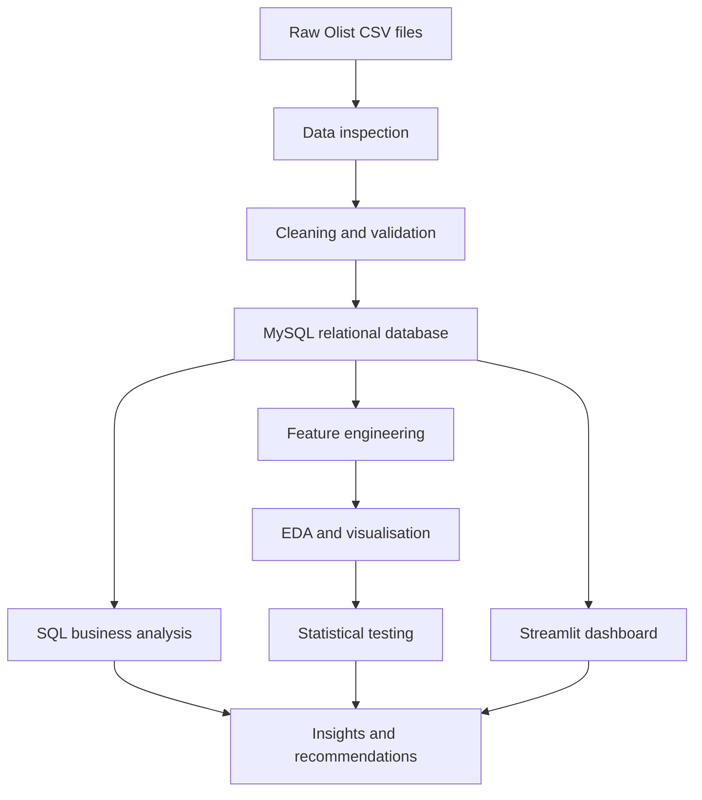

# Cart2Insights: Decoding E-Commerce Performance

Cart2Insights is an end-to-end e-commerce analytics project built with Python, pandas, MySQL, SQLAlchemy, statistical testing, and Streamlit. It transforms the Brazilian Olist dataset into a relational database, engineered analytical features, reproducible notebooks, and an interactive business-intelligence dashboard.

## Business objective

The project answers questions about:

- sales and gross order value trends;
- customer acquisition and repeat purchases;
- product category, product, and seller performance;
- delivery speed and delay rates;
- customer review behaviour;
- payment methods and order outcomes.

## Dataset
The project uses nine source tables:

| Table | Description |
|---|---|
| `customers` | Customer identifiers and location |
| `geolocation` | Postal prefixes and coordinates |
| `orders` | Order status and timestamps |
| `order_items` | Products, sellers, prices, and freight |
| `payments` | Payment method, instalments, and value |
| `reviews` | Review scores and comments |
| `products` | Product category and physical attributes |
| `sellers` | Seller identifiers and location |
| `category_translation` | Portuguese-to-English category names |

Raw and generated datasets are intentionally excluded from Git. Download the CSV files and place them in `data/raw/`.

## Technology stack

- Python 3.12
- pandas and NumPy
- MySQL
- SQLAlchemy and PyMySQL
- Matplotlib and Seaborn
- SciPy
- Streamlit
- Jupyter Notebook
- Git and GitHub

## Project workflow



## Repository structure

```text
Cart2Insights/
|-- data/
|   |-- raw/                 # Downloaded source CSVs (ignored)
|   |-- cleaned/             # Generated cleaned CSVs (ignored)
|   `-- processed/           # Generated feature files (ignored)
|-- docs/
|   |-- ERD.md
|   |-- business_insights.md
|   `-- links.txt
|-- notebooks/
|   |-- 01_data_inspection.ipynb
|   |-- 02_data_cleaning.ipynb
|   |-- 03_mysql_data_load.ipynb
|   |-- 04_sql_analysis.ipynb
|   |-- 05_feature_engineering.ipynb
|   |-- 06_eda.ipynb
|   `-- 07_statistical_analysis.ipynb
|-- sql/
|   `-- 01_create_schema.sql
|-- streamlit/
|   `-- app.py
|-- .gitignore
|-- README.md
`-- requirements.txt
```

## Metric definitions

The project keeps related financial measures separate:

- **Product revenue:** sum of item `price`.
- **Freight value:** sum of `freight_value`.
- **Gross order value:** `price + freight_value` for delivered orders.
- **Payment value:** amount recorded in the payments table.

## Setup

### 1. Clone and install dependencies

```bash
git clone https://github.com/Visvatharsan/cart2insights-ecommerce-analytics.git
cd cart2insights-ecommerce-analytics
python -m venv .venv
```

Windows activation:

```powershell
.venv\Scripts\Activate.ps1
pip install -r requirements.txt
```

### 2. Prepare the data

Download the Olist CSV files and place them in `data/raw/`. Run:

1. `01_data_inspection.ipynb`
2. `02_data_cleaning.ipynb`

The cleaning notebook generates `data/cleaned/` without modifying the raw files.

### 3. Create and load MySQL

Execute:

```text
sql/01_create_schema.sql
```

Then run `03_mysql_data_load.ipynb`. It loads tables in dependency order and verifies row counts and relationships.

### 4. Run the analysis

Run notebooks 04 through 07 in order:

- SQL analysis
- feature engineering
- exploratory data analysis
- statistical hypothesis testing

### 5. Configure Streamlit

Create `.streamlit/secrets.toml`:

```toml
[mysql]
username = "root"
password = "your_password"
host = "localhost"
port = 3306
database = "cart2insights"
```

Never commit this file. It is already excluded by `.gitignore`.

### 6. Start the dashboard

```powershell
streamlit run streamlit/app.py
```

## Dashboard pages

- Overview
- Sales Analysis
- Customer Analysis
- Seller & Product Analysis
- Delivery Analysis
- Customer Experience
- Insights & Recommendations

The sidebar includes month, state, and category filters plus a data-refresh control.

## Key results

- On-time delivery review score: **4.29**
- Delayed delivery review score: **2.57**
- Delivery days versus review score correlation: **-0.33**
- Repeat-customer rate: **3.00%**
- Leading category: **beleza_saude**
- Peak gross-order-value month: **November 2017**

## Security and reproducibility

- Credentials are entered with `getpass()` in notebooks or read from Streamlit secrets.
- Raw, cleaned, and processed datasets are ignored by Git.
- Database loading uses `if_exists="append"` to preserve schema constraints.
- Notebooks use project-relative paths.

## Author

**Visvatharsan**
