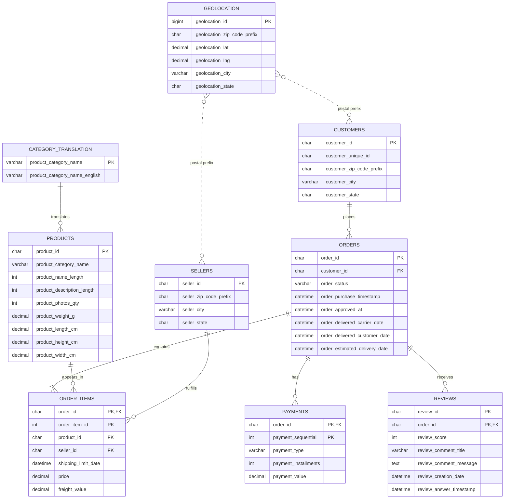

# Cart2Insights Entity-Relationship Diagram

## Relationship notes

- `customer_id` identifies a customer record associated with an order, while `customer_unique_id` identifies the same buyer across different orders.
- `order_items` uses the composite primary key `(order_id, order_item_id)`.
- `payments` uses `(order_id, payment_sequential)` because an order can have multiple payment records.
- `reviews` uses `(review_id, order_id)` in this project schema.
- Geolocation joins are logical rather than enforced foreign keys because a postal-code prefix can have multiple coordinate records.
- Category translation is a lookup relationship. Products with missing categories are represented as `unknown`.
